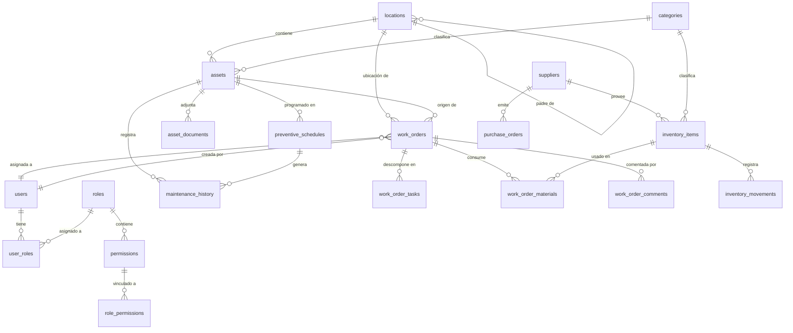

# MaintCore — Arquitectura del Sistema GMAO/CMMS

> **Estado:** Propuesta de arquitectura — Pendiente de validación  
> **Fecha:** 2026-10-20  
> **Autor:** Arquitecto Software Senior (asistente IA)

---

## Tabla de contenidos

1. [Resumen del sistema](#1-resumen-del-sistema)
2. [Estructura de directorios propuesta](#2-estructura-de-directorios-propuesta)
3. [Modelo entidad-relación](#3-modelo-entidad-relación)
4. [Estructura del backend FastAPI](#4-estructura-del-backend-fastapi)
5. [Estructura del frontend React](#5-estructura-del-frontend-react)
6. [Roadmap técnico detallado](#6-roadmap-técnico-detallado)
7. [Riesgos de diseño](#7-riesgos-de-diseño)
8. [Mejoras recomendadas](#8-mejoras-recomendadas)

---

## 1. Resumen del sistema

**MaintCore** es un GMAO (Gestión de Mantenimiento Asistido por Ordenador), también conocido como CMMS en inglés. Su propósito es centralizar la gestión de mantenimientos preventivos, correctivos y predictivos de activos industriales/empresariales.

### Pilas tecnológicas

| Capa | Tecnología | Justificación |
|------|-----------|---------------|
| Backend | Python 3.12+ / FastAPI | Async-native, tipado fuerte, docs automáticas (OpenAPI/Swagger) |
| ORM | SQLAlchemy 2.0 (estilo declarativo) | Madurez, compatibilidad con async, migraciones con Alembic |
| Base de datos | PostgreSQL 16+ | ACID completo, JSONB, extensiones avanzadas (PostGIS si se requiere) |
| Autenticación | JWT + refresh tokens | Stateless, escalable, estándar de la industria |
| Frontend | React 19 / TypeScript / Vite | Ecosistema maduro, tipado estático, build rápido |
| UI Framework | Material UI (MUI v6) | Componentes accesibles, temas personalizables, responsive |
| Estado cliente | Zustand + TanStack Query | Ligero + gestión de estado remoto |
| Testing backend | pytest + httpx + Factory Boy | Estándar Python, fixtures potentes |
| Testing frontend | Vitest + React Testing Library | Rápido, integrado con Vite |
| CI/CD | GitHub Actions | Integración nativa con repos |

### Principios de organización

- **Clean Architecture / Hexagonal**: Separación clara entre capa de presentación (API), lógica de negocio (services) y acceso a datos (repositories).
- **SOLID**: Cada módulo sigue principios de responsabilidad única y apertura/cierre.
- **Feature-oriented**: Los módulos se agrupan por dominio, no por tipo técnico.

---

## 2. Estructura de directorios propuesta

```
MaintCore/
├── README.md                          # Descripción general, requisitos, setup
├── ARCHITECTURE.md                    # Este documento
├── docker-compose.yml                 # Orquestación local (Postgres, pgAdmin, backend, frontend)
├── .env.example                       # Variables de entorno base
│
├── backend/
│   ├── README.md                      # Guía de desarrollo del backend
│   ├── pyproject.toml                 # Dependencias y metadatos (PEP 621)
│   ├── Dockerfile                     # Imagen de producción
│   ├── alembic.ini                    # Configuración de Alembic
│   ├── alembic/
│   │   ├── env.py
│   │   ├── script.py.mako
│   │   └── versions/                  # Migraciones automáticas
│   │
│   ├── fastapi_app/
│   │   ├── __init__.py
│   │   ├── main.py                    # Aplicación FastAPI (app factory)
│   │   ├── config.py                  # Settings con pydantic-settings
│   │   ├── database.py                # Engine, session, base
│   │   ├── dependencies.py            # Deps compartidas (get_db, get_current_user)
│   │   ├── security.py               # JWT, hashing, OAuth2
│   │   ├── scheduler.py              # APScheduler para mantenimientos preventivos
│   │   │
│   │   ├── models/                    # Modelos SQLAlchemy (tablas)
│   │   │   ├── __init__.py
│   │   │   ├── user.py
│   │   │   ├── role.py
│   │   │   ├── asset.py
│   │   │   ├── work_order.py
│   │   │   ├── preventive_schedule.py
│   │   │   ├── inventory.py
│   │   │   ├── supplier.py
│   │   │   ├── document.py
│   │   │   ├── location.py
│   │   │   └── audit_log.py
│   │   │
│   │   ├── schemas/                   # Pydantic schemas (request/response)
│   │   │   ├── __init__.py
│   │   │   ├── user.py
│   │   │   ├── role.py
│   │   │   ├── asset.py
│   │   │   ├── work_order.py
│   │   │   ├── preventive_schedule.py
│   │   │   ├── inventory.py
│   │   │   ├── supplier.py
│   │   │   ├── document.py
│   │   │   └── auth.py
│   │   │
│   │   ├── api/                       # Routers (endpoints)
│   │   │   ├── __init__.py
│   │   │   ├── users.py
│   │   │   ├── auth.py
│   │   │   ├── assets.py
│   │   │   ├── work_orders.py
│   │   │   ├── preventive_schedules.py
│   │   │   ├── inventory.py
│   │   │   ├── suppliers.py
│   │   │   ├── documents.py
│   │   │   ├── locations.py
│   │   │   ├── reports.py
│   │   │   └── dashboard.py
│   │   │
│   │   ├── services/                  # Lógica de negocio
│   │   │   ├── __init__.py
│   │   │   ├── user_service.py
│   │   │   ├── asset_service.py
│   │   │   ├── work_order_service.py
│   │   │   ├── preventive_service.py
│   │   │   ├── inventory_service.py
│   │   │   ├── supplier_service.py
│   │   │   ├── document_service.py
│   │   │   ├── report_service.py
│   │   │   └── notification_service.py
│   │   │
│   │   ├── repositories/              # Acceso a datos (patrón repo)
│   │   │   ├── __init__.py
│   │   │   ├── user_repo.py
│   │   │   ├── asset_repo.py
│   │   │   ├── work_order_repo.py
│   │   │   ├── preventive_repo.py
│   │   │   ├── inventory_repo.py
│   │   │   └── supplier_repo.py
│   │   │
│   │   ├── middleware/                # Middlewares personalizados
│   │   │   ├── __init__.py
│   │   │   ├── audit.py
│   │   │   └── request_logging.py
│   │   │
│   │   ├── utils/                     # Utilidades
│   │   │   ├── __init__.py
│   │   │   ├── pdf_generator.py
│   │   │   ├── excel_exporter.py
│   │   │   └── validators.py
│   │   └── exceptions/                # Manejo centralizado de errores
│   │       ├── __init__.py
│   │       └── handlers.py
│   │
│   └── tests/
│       ├── conftest.py                # Fixtures globales
│       ├── test_auth.py
│       ├── test_users.py
│       ├── test_assets.py
│       ├── test_work_orders.py
│       ├── test_inventory.py
│       ├── test_preventive.py
│       └── fixtures/                  # Datos de prueba
```

### Estructura del frontend React

```
frontend/
├── README.md                      # Guía de desarrollo del frontend
├── package.json
├── tsconfig.json
├── vite.config.ts
├── Dockerfile                     # Imagen de producción (Nginx)
├── .env.example
│
└── react-app/
    ├── index.html
    ├── public/
    │   └── favicon.ico
    │
    ├── src/
    │   ├── main.tsx               # Punto de entrada
    │   ├── App.tsx                # Root component + Router
    │   ├── vite-env.d.ts
    │   │
    │   ├── assets/                # Imágenes, iconos
    │   │
    │   ├── components/            # Componentes reutilizables
    │   │   ├── common/            # Botones, tablas, formularios base
    │   │   ├── layout/            # Layouts de la app
    │   │   └── modals/            # Diálogos reutilizables
    │   │
    │   ├── pages/                 # Páginas de la aplicación
    │   │   ├── LoginPage.tsx
    │   │   ├── DashboardPage.tsx
    │   │   ├── AssetsPage.tsx
    │   │   ├── WorkOrdersPage.tsx
    │   │   ├── PreventivePage.tsx
    │   │   ├── InventoryPage.tsx
    │   │   ├── SuppliersPage.tsx
    │   │   ├── DocumentsPage.tsx
    │   │   ├── LocationsPage.tsx
    │   │   ├── ReportsPage.tsx
    │   │   └── SettingsPage.tsx
    │   │
    │   ├── hooks/                 # Custom React hooks
    │   ├── contexts/              # React Context (tema, auth)
    │   ├── services/              # Comunicación con API
    │   ├── stores/                # Zustand stores (estado local)
    │   ├── types/                 # Interfaces TypeScript
    │   ├── utils/                 # Utilidades frontend
    │   └── theme/                 # Configuración MUI
    │
    └── tests/
        ├── setup.ts
        ├── pages/
        ├── components/
        └── utils/
```

### Principios de organización del frontend

- **Componentes atómicos**: Separar componentes en atoms, molecules y organisms.
- **Pages como orquestadores**: Las páginas ensamblan componentes sin lógica compleja.
- **Services como adaptadores**: Cada servicio mapea la API a interfaces tipadas.
- **Zustand para estado local**: Solo lo que no viene del servidor.
- **TanStack Query para estado remoto**: Caché, revalidación, optimistic updates.

---

## 3. Modelo entidad-relación

### 3.1 Diagrama ER (Mermaid)



### 3.2 Descripción de entidades principales

#### users
- Usuario del sistema con credenciales de acceso.
- Relación many-to-many con roles.
- Puede ser creador, asignado y comentarista de work orders.

#### roles / permissions
- Sistema RBAC (Role-Based Access Control).
- Roles predefinidos: `Admin`, `Manager`, `Technician`, `Operator`, `Viewer`.
- Permisos granulares por módulo (assets, work_orders, inventory, etc.).

#### locations
- Jerarquía de ubicaciones (empresa -> planta -> área -> línea -> puesto).
- Auto-relacionable mediante `parent_id`.
- Cada asset y work_order se vincula a una ubicación.

#### assets
- Activo principal del GMAO (máquina, equipo, vehículo, instalación).
- Campos: serial, nombre, categoría, ubicación, fabricante, fecha compra, costo, depreciación, garantía.
- Estado: `active`, `inactive`, `in_maintenance`, `decommissioned`.
- Especificaciones extensibles vía JSONB.

#### categories
- Clasificación de assets e inventory items.
- Jerarquía auto-relacionable (tipo -> subtipo -> modelo).
- Distingue entre categorías de `asset` e `inventory`.

#### work_orders (WO)
- Corazón del GMAO. Tipo: `preventive`, `corrective`, `predictive`.
- Prioridad: `low`, `medium`, `high`, `critical`.
- Estado: `draft` -> `planned` -> `in_progress` -> `completed` / `cancelled` / `on_hold`.
- Desglose en tareas (`work_order_tasks`).
- Consumo de materiales (`work_order_materials`).
- Comentarios y seguimiento temporal (scheduled vs actual).

#### preventive_schedules
- Programación automática de mantenimientos preventivos.
- Frecuencia configurable: diaria, semanal, mensual, trimestral, anual o custom.
- Genera work_orders automáticamente al cumplirse la fecha.

#### maintenance_history
- Historial completo de intervenciones por activo.
- Incluye tipo, fecha, descripción, costo, responsable y observaciones.
- Base para KPIs y análisis de fiabilidad.

#### inventory_items / inventory_movements
- Control de stock de repuestos y consumibles.
- Movimientos: entrada, salida, ajuste, transferencia.
- Referenciados por work orders y purchase orders.
- Umbral mínimo/máximo con alertas.

#### suppliers
- Proveedores de repuestos y servicios.
- Contacto, dirección, metadata extensible.
- Vinculado a inventory items y purchase orders.

#### purchase_orders
- Órdenes de compra a proveedores.
- Estado: `draft` -> `approved` -> `ordered` -> `received` / `cancelled`.
- Seguimiento de entregas y costes.

#### asset_documents
- Documentos adjuntos a activos (manuales, certificados, planos).
- Almacenamiento de ruta de archivo + metadatos.

#### audit_logs
- Registro inmutable de acciones críticas.
- Tracking de quién hizo qué, cuándo y desde dónde.
- Captura old_values / new_values en updates.

---

## 4. Estructura del backend FastAPI

### 4.1 Patrón de capas

```
┌─────────────────────────────────────────────────────┐
│                    API Layer                         │
│  (Routers + Pydantic Schemas + Dependencies)        │
│  - Validación de requests/responses                 │
│  - Autenticación y autorización                      │
│  - Serialización                                    │
├─────────────────────────────────────────────────────┤
│                  Service Layer                       │
│  (Lógica de negocio + Orquestación)                 │
│  - Reglas de negocio                                │
│  - Transacciones                                    │
│  - Coordinación entre repos                         │
│  - Generación de eventos                            │
├─────────────────────────────────────────────────────┤
│               Repository Layer                       │
│  (Acceso a datos + Query building)                  │
│  - Operaciones CRUD                                 │
│  - Queries complejas                                │
│  - Paginación, filtrado, ordenación                 │
│  - Mapeo Model<->Entity                             │
├─────────────────────────────────────────────────────┤
│                  Model Layer                         │
│  (SQLAlchemy ORM + Tablas)                          │
│  - Definición de esquemas                           │
│  - Relaciones                                       │
│  - Constraints                                      │
├─────────────────────────────────────────────────────┤
│              Database (PostgreSQL)                   │
└─────────────────────────────────────────────────────┘
```

### 4.2 Detalles por capa

#### API Layer (`fastapi_app/api/`)
- Un router por módulo de dominio.
- Endpoints con tipado fuerte (request body, query params, path params).
- Respuestas estandarizadas con paginación (`PaginationResponse`).
- Documentación automática vía OpenAPI/Swagger.

#### Service Layer (`fastapi_app/services/`)
- Clases o funciones que encapsulan la lógica de negocio.
- Reciben repositorios inyectados (patrón DI).
- Manejan transacciones con `session.begin()`.
- Generan eventos para notificaciones y scheduler.

#### Repository Layer (`fastapi_app/repositories/`)
- Clase por entidad con métodos CRUD.
- Queries complejas con SQLAlchemy 2.0 (`select()`, `join()`, `where()`).
- Paginación genérica con offset/limit.
- Filtrado dinámico y ordenación.

#### Model Layer (`fastapi_app/models/`)
- Tablas SQLAlchemy con UUID como PK.
- Campos comunes: `created_at`, `updated_at` (auto-managed).
- Enums para estados y tipos.
- Índices compuestos en campos de consulta frecuente.

### 4.3 Seguridad

- **Autenticación**: OAuth2PasswordBearer + JWT (access token 15 min, refresh token 7 días).
- **Autorización**: Middleware que verifica permisos del rol del usuario.
- **Contraseñas**: bcrypt con salt rounds = 12.
- **CORS**: Whitelist de orígenes configurable.
- **Rate limiting**: Limiter por IP en endpoints sensibles (login, registro).

### 4.4 Scheduler (Mantenimientos preventivos)

- **APScheduler** integrado como background task de FastAPI.
- Verifica `preventive_schedules` activas cada minuto.
- Genera work_orders automáticos cuando `next_due_date <= now`.
- Tolerancia a fallos: reintentos con backoff exponencial.

### 4.5 Manejo de errores

- Excepciones personalizadas (`MaintCoreException` base).
- Subclases: `NotFoundError`, `ValidationError`, `PermissionError`, `BusinessRuleError`.
- Middleware centralizado que convierte excepciones en respuestas HTTP estandarizadas.
- Logging estructurado con correlación (request ID).

### 4.6 Testing backend

- **pytest** como framework principal.
- **httpx** para testing de endpoints (test client ASGI).
- **Factory Boy** / **factory_boy** para generación de datos de prueba.
- **pytest-asyncio** para tests asíncronos.
- **coverage.py** para métricas de cobertura (objetivo: >80%).
- Base de datos PostgreSQL en Docker para tests integration.

---

## 5. Estructura del frontend React

### 5.1 Arquitectura de la aplicación

```
┌─────────────────────────────────────────────────────┐
│                  Pages Layer                         │
│  (LoginPage, DashboardPage, AssetsPage, ...)        │
│  - Orquestan componentes                            │
│  - Suscriben a datos con TanStack Query             │
│  - Manejan navegación                               │
├─────────────────────────────────────────────────────┤
│              Components Layer                        │
│  (common/, layout/, modals/)                        │
│  - Componentes reutilizables                        │
│  - Layouts y shell de la app                        │
│  - Formularios con React Hook Form                  │
├─────────────────────────────────────────────────────┤
│               State Layer                            │
│  (Zustand stores + React Context)                   │
│  - authStore: token, user info                      │
│  - uiStore: sidebar, theme                          │
│  - notificationStore: alerts, toasts                │
├─────────────────────────────────────────────────────┤
│             Services Layer                           │
│  (apiClient + *.service.ts)                         │
│  - Axios instance con interceptors                  │
│  - Refresh token automático                         │
│  - Mapeo API <-> TypeScript types                   │
├─────────────────────────────────────────────────────┤
│              Backend API (FastAPI)                   │
└─────────────────────────────────────────────────────┘
```

### 5.2 Decisiones de diseño frontend

#### Routing
- **React Router v6** con rutas anidadas.
- Rutas protegidas con `AuthGuard` (redirige a login si no autenticado).
- Rutas con permisos: `ProtectedRoute` verifica RBAC del usuario.
- Lazy loading de páginas con `React.lazy()` + `Suspense`.

#### Gestión de estado
- **TanStack Query** (React Query): caché de datos del servidor, revalidación en background, optimistic updates.
- **Zustand**: estado UI local (sidebar colapsada, tema, notificaciones).
- **React Context**: solo para auth y theme (acceso global pero poco frecuente).

#### Formularios
- **React Hook Form** + **Zod** para validación.
- Esquemas Zod compartidos con backend (validación en doble capa).
- Campos reutilizables: `TextField`, `SelectField`, `DatePicker`, `FileUpload`.

#### Tablas de datos
- Componente `DataTable` genérico con paginación del servidor, ordenación, filtrado y exportación CSV/Excel.

#### UI / Theming
- **Material UI v6** como sistema de diseño base.
- Tema personalizado con paleta corporativa. Modo claro/oscuro toggleable.

#### Internacionalización (i18n)
- **react-i18next** para traducciones. Soporte inicial: español e inglés.

### 5.3 Testing frontend

- **Vitest** + **React Testing Library** para unit tests.
- **MSW (Mock Service Worker)** para mockear la API.
- **Playwright** para E2E tests críticos.
- Cobertura objetivo: >70% en componentes críticos.

- Cobertura objetivo: >70% en componentes críticos.

---

## 6. Roadmap técnico detallado

### Fase 0 — Fundamentos (Semanas 1-2)

| # | Tarea | Backend | Frontend | Duración |
|---|-------|---------|----------|----------|
| 0.1 | Setup del repositorio y CI/CD | ✅ pyproject.toml, pre-commit hooks | ✅ package.json, ESLint, Prettier | 2 días |
| 0.2 | Docker Compose local | ✅ postgres, pgAdmin | ✅ vite dev server | 1 día |
| 0.3 | Configuración FastAPI base | ✅ app factory, config, database, logging | — | 2 días |
| 0.4 | Configuración React base | — ✅ Vite + TypeScript + MUI | ✅ Router, AuthContext | 2 días |
| 0.5 | Base de datos + Alembic | ✅ migración inicial (users, roles, permissions) | — | 1 día |

**Entregable:** App arranca localmente, DB conectada, CI pasa en push.

---

### Fase 1 — Autenticación y Usuarios (Semanas 3-4)

| # | Tarea | Backend | Frontend | Duración |
|---|-------|---------|----------|----------|
| 1.1 | Modelos User, Role, Permission | ✅ modelos + migraciones | — | 2 días |
| 1.2 | Repositorios y Services | ✅ CRUD users/roles/permissions | — | 2 días |
| 1.3 | Auth endpoints (login, logout, refresh) | ✅ JWT, OAuth2 | — | 2 días |
| 1.4 | RBAC middleware | ✅ verificación de permisos | — | 1 día |
| 1.5 | Login page frontend | — ✅ formulario + validación | ✅ 1 día |
| 1.6 | Auth context + protected routes | — ✅ React Context + guards | ✅ 2 días |
| 1.7 | User management (CRUD) | ✅ endpoints | ✅ páginas + formularios | 3 días |
| 1.8 | Tests de autenticación | ✅ unit + integration | ✅ component tests | 2 días |

**Entregable:** Usuarios pueden registrarse, loguearse, gestionar roles y permisos.

---

### Fase 2 — Gestión de Ubicaciones y Categorías (Semanas 5-6)

| # | Tarea | Backend | Frontend | Duración |
|---|-------|---------|----------|----------|
| 2.1 | Modelos Location, Category | ✅ modelos + migraciones | — | 1 día |
| 2.2 | CRUD jerárquico (tree) | ✅ services con recursión | — | 2 días |
| 2.3 | API endpoints | ✅ routers con tree view | — | 1 día |
| 2.4 | Frontend: Location tree | — ✅ árbol interactivo MUI | ✅ 3 días |
| 2.5 | Frontend: Category manager | — ✅ tabla + formulario | ✅ 2 días |
| 2.6 | Tests | ✅ integration tests | ✅ component tests | 1 día |

**Entregable:** Estructura jerárquica de ubicaciones y categorías operativa.

---

### Fase 3 — Gestión de Activos (Semanas 7-9)

| # | Tarea | Backend | Frontend | Duración |
|---|-------|---------|----------|----------|
| 3.1 | Modelo Asset completo | ✅ modelo + migraciones | — | 2 días |
| 3.2 | CRUD assets + búsqueda avanzada | ✅ repo con filtros, paginación | — | 3 días |
| 3.3 | Upload de documentos | ✅ endpoints + storage | — | 2 días |
| 3.4 | Frontend: Asset list (DataTable) | — ✅ tabla con filtros | ✅ 3 días |
| 3.5 | Frontend: Asset detail page | — ✅ vista detalle + tabs | ✅ 3 días |
| 3.6 | Frontend: Asset create/edit form | — ✅ formulario completo | ✅ 2 días |
| 3.7 | Historial de mantenimiento (linked) | ✅ endpoint agregado | — | 1 día |
| 3.8 | Tests | ✅ unit + integration | ✅ component tests | 2 días |

**Entregable:** Catálogo completo de activos con búsqueda, detalle y documentos adjuntos.

---

### Fase 4 — Órdenes de Trabajo (Semanas 10-13)

| # | Tarea | Backend | Frontend | Duración |
|---|-------|---------|----------|----------|
| 4.1 | Modelos WO, Task, Material | ✅ modelos + migraciones | — | 2 días |
| 4.2 | CRUD Work Orders completo | ✅ services con transacciones | — | 4 días |
| 4.3 | Estados y workflow de WO | ✅ máquina de estados | — | 2 días |
| 4.4 | Gestión de tareas de WO | ✅ endpoints | — | 2 días |
| 4.5 | Consumo de materiales | ✅ validación de stock | — | 2 días |
| 4.6 | Frontend: WO list (DataTable) | — ✅ tabla + filtros + tabs por estado | ✅ 3 días |
| 4.7 | Frontend: WO detail page | — ✅ vista detalle completa | ✅ 4 días |
| 4.8 | Frontend: WO create wizard | — ✅ formulario multi-paso | ✅ 3 días |
| 4.9 | Frontend: WO Kanban board | — ✅ tablero visual por estado | ✅ 3 días |
| 4.10 | Tests | ✅ unit + integration | ✅ component + E2E | 3 días |

**Entregable:** Sistema completo de órdenes de trabajo con workflow, tareas y consumo de materiales.

---

### Fase 5 — Mantenimiento Preventivo (Semanas 14-15)

| # | Tarea | Backend | Frontend | Duración |
|---|-------|---------|----------|----------|
| 5.1 | Modelo Preventive Schedule | ✅ modelo + migraciones | — | 1 día |
| 5.2 | CRUD schedules | ✅ services | — | 2 días |
| 5.3 | APScheduler integration | ✅ scheduler background task | — | 3 días |
| 5.4 | Generación automática de WOs | ✅ lógica + transacciones | — | 2 días |
| 5.5 | Frontend: Schedule list | — ✅ tabla + formulario | ✅ 2 días |
| 5.6 | Frontend: Schedule detail + calendar view | — ✅ vista calendario MUI | ✅ 3 días |
| 5.7 | Tests | ✅ unit + integration | ✅ component tests | 1 día |

**Entregable:** Programación automática de mantenimientos preventivos con generación de WOs.

---

### Fase 6 — Inventario y Proveedores (Semanas 16-17)

| # | Tarea | Backend | Frontend | Duración |
|---|-------|---------|----------|----------|
| 6.1 | Modelos Inventory, Supplier, PO | ✅ modelos + migraciones | — | 2 días |
| 6.2 | CRUD inventory + movimientos | ✅ services con transacciones | — | 3 días |
| 6.3 | Purchase orders workflow | ✅ endpoints | — | 2 días |
| 6.4 | Alertas de stock bajo | ✅ scheduler check | — | 1 día |
| 6.5 | Frontend: Inventory list + detail | — ✅ tabla + vista detalle | ✅ 3 días |
| 6.6 | Frontend: Supplier management | — ✅ CRUD completo | ✅ 2 días |
| 6.7 | Frontend: Purchase orders | — ✅ wizard de creación | ✅ 2 días |
| 6.8 | Tests | ✅ unit + integration | ✅ component tests | 1 día |

**Entregable:** Control de inventario, proveedores y órdenes de compra.

---

### Fase 7 — Dashboard, Reportes y KPIs (Semanas 18-19)

| # | Tarea | Backend | Frontend | Duración |
|---|-------|---------|----------|----------|
| 7.1 | Endpoints de dashboard | ✅ agregaciones SQL optimizadas | — | 3 días |
| 7.2 | KPIs: MTBF, MTTR, OEE, WO backlog | ✅ cálculos + caching | — | 2 días |
| 7.3 | Reportes PDF/Excel | ✅ generators | — | 2 días |
| 7.4 | Frontend: Dashboard con gráficos | — ✅ MUI Charts / Recharts | ✅ 4 días |
| 7.5 | Frontend: Reports page | — ✅ export controls | ✅ 2 días |
| 7.6 | Tests | ✅ integration tests | ✅ component tests | 1 día |

**Entregable:** Panel de control con KPIs en tiempo real y generación de reportes.

---

### Fase 8 — Pulido, Documentación y Despliegue (Semanas 20-21)

| # | Tarea | Backend | Frontend | Duración |
|---|-------|---------|----------|----------|
| 8.1 | Hardening de seguridad | ✅ audit completo | — | 2 días |
| 8.2 | Optimización de queries | ✅ índices + profiling | — | 2 días |
| 8.3 | PWA support | — ✅ service worker | ✅ 2 días |
| 8.4 | Documentación API (OpenAPI) | ✅ auto-generada | — | 1 día |
| 8.5 | User documentation | ✅ runbooks | ✅ user guide | 3 días |
| 8.6 | Docker production images | ✅ multi-stage build | ✅ Nginx config | 2 días |
| 8.7 | Staging deployment | ✅ CI/CD pipeline | ✅ deploy script | 2 días |
| 8.8 | UAT + bug fixes | ✅ hotfixes | ✅ hotfixes | 3 días |

**Entregable:** Sistema listo para producción con documentación completa.

---

### Resumen del roadmap

```
Fase 0: Fundamentos          ████████░░░░░░░░░░░░░░░░  Semanas 1-2
Fase 1: Auth y Usuarios      ░░░░████████░░░░░░░░░░░░  Semanas 3-4
Fase 2: Ubicaciones/Cats     ░░░░░░░░░░████████░░░░░░  Semanas 5-6
Fase 3: Activos              ░░░░░░░░░░░░░░████████░░  Semanas 7-9
Fase 4: Work Orders          ░░░░░░░░░░░░░░░░░░██████  Semanas 10-13
Fase 5: Preventivo           ░░░░░░░░░░░░░░░░░░░░████  Semanas 14-15
Fase 6: Inventario/Proveed.  ░░░░░░░░░░░░░░░░░░░░░░██  Semanas 16-17
Fase 7: Dashboard/Reportes   ░░░░░░░░░░░░░░░░░░░░░░░█  Semanas 18-19
Fase 8: Pulido/Deploy        ░░░░░░░░░░░░░░░░░░░░░░░█  Semanas 20-21

Total estimado: ~21 semanas (~5 meses) con 1 dev backend + 1 dev frontend
```
---

## 7. Riesgos de diseño

### 7.1 Dependencia de PostgreSQL

PostgreSQL es el único motor de base de datos soportado. Esto implica:

- **Vendor lock-in**: Migrar a otro SDBM (MySQL, MariaDB, CockroachDB) requeriría reescribir migraciones, ajustar queries con funciones específicas (JSONB, CTEs recursivas) y rehacer benchmarks de rendimiento.
- **Single point of failure**: En la configuración actual (un solo nodo), una caída de PostgreSQL inutiliza todo el sistema. No se ha definido estrategia de réplica read-only ni failover automático.
- **Limitaciones de escalabilidad write**: Para escenarios con >500 técnicos generando WOs simultáneamente, PostgreSQL puede requerir tuning agresivo de connection pooling (PgBouncer) y particionamiento de tablas.

**Mitigación**: Definir SLA de disponibilidad antes de producción. Si se requiere 99.9%+, implementar réplica read-only + Patroni para auto-failover. Evaluar particionamiento de `work_orders` y `maintenance_history` por rango de fecha cuando se superen ~500K registros.

### 7.2 Gestión de migraciones

Alembic gestiona las migraciones de esquema, pero existen riesgos:

- **Conflictos en desarrollo paralelo**: Si dos desarrolladores generan migraciones simultáneamente sin coordinar, pueden producirse conflictos de versión o pérdida de cambios.
- **Migraciones destructivas**: Una migración que elimina o modifica columnas puede romper instancias en producción si no se ejecuta en el orden correcto.
- **Datos semilla**: Las migraciones de datos (INSERT/UPDATE masivos) pueden bloquear tablas en producción durante horas.

**Mitigación**: Establecer convención de naming `YYYYMMDD_HHMM_description`. Usar `alembic merge` para fusionar ramas antes de merge a main. Separar migraciones de esquema de migraciones de datos. Probar siempre en staging con dataset real antes de producción.

### 7.3 Complejidad creciente de permisos RBAC

El modelo RBAC actual define roles fijos (admin, manager, technician, viewer). Los riesgos son:

- **Permisos por entidad**: Si un cliente necesita permisos granulares (ej: `técnico A solo ve activos del área B`), el modelo actual no lo soporta sin extensiones.
- **Herencia de roles**: La relación `role_permissions` es many-to-many sin jerarquía. Crear un rol `senior_technician` con superconjunto de permisos requiere asignación manual.
- **Drift de permisos**: Sin auditoría de cambios en roles/permisos, es difícil detectar configuraciones inconsistentes.

**Mitigación**: Considerar ABAC (Attribute-Based Access Control) para permisos contextuales. Implementar endpoint de auditoría de permisos. Documentar matriz de permisos por rol y actualizarla en cada PR que modifique `role_permissions`.

### 7.4 Cobertura insuficiente de tests E2E

La estrategia de testing actual cubre unit tests (pytest) y component tests (Vitest), pero:

- **Flujos integrados no probados**: El workflow completo de WO (crear → planificar → ejecutar → completar → consumir materiales) no tiene tests end-to-end que validen la integración frontend ↔ API ↔ base de datos.
- **Regresiones de UI**: Sin Cypress o Playwright, cambios en componentes React pueden romper flujos críticos sin detección automática.
- **Performance regression**: No hay baseline de tiempos de respuesta que detecte degradación progresiva.

**Mitigación**: Incluir al menos 5 tests E2E críticos (login, crear WO, aprobar WO, ver dashboard, exportar reporte) con Playwright en Fase 8. Configurar benchmark de API con k6 para detectar regresiones >20% en tiempo de respuesta.

### 7.5 Riesgo de deuda técnica en módulos legacy

Si MaintCore se integra con sistemas existentes:

- **Adaptadores frágiles**: Los wrappers para APIs legacy pueden ocultar comportamientos no documentados que rompen funcionalidades silenciosamente.
- **Datos inconsistentes**: La migración desde spreadsheets o GMAO antiguos puede introducir duplicados, formatos incorrectos o referencias rotas.
- **Conocimiento concentrado**: Si solo una persona entiende la integración legacy, su ausencia genera riesgo operativo.

**Mitigación**: Documentar cada adaptador con ejemplos de entrada/salida. Validar datos migrados con cross-checks automatizados. Crear runbook de recuperación ante fallos de integración.

---

## 8. Mejoras recomendadas

### 8.1 Observabilidad (OpenTelemetry / Métricas)

**Estado actual**: Logging básico con `logging` de Python y `console.log` en frontend.

**Propuesta**:
- Integrar **OpenTelemetry** para tracing distribuido (request IDs que atraviesan frontend → API → DB).
- Exponer métricas Prometheus en `/metrics` (latencia P50/P95/P99, errores por endpoint, cola de scheduler).
- Dashboard Grafana con alertas basadas en SLOs (ej: `si error rate >1% durante 5 min, notificar`).
- Correlation IDs en headers (`X-Request-ID`) para trazar solicitudes a través de todos los servicios.

**Prioridad**: Alta. Sin observabilidad, el debugging en producción es reactivo y lento.

### 8.2 Caché distribuida (Redis)

**Estado actual**: Sin caché. Cada request de dashboard o lista ejecuta queries directas a PostgreSQL.

**Propuesta**:
- **Redis** como caché de respuesta para endpoints costosos (dashboard KPIs, listas paginadas).
- TTL configurable por endpoint (5 min para KPIs, 1 min para listas, invalidación inmediata para writes).
- Cache-aside pattern en services: verificar caché antes de query, populate on miss.
- Redis como backend para token blacklist (revocación JWT) y lock distribuido (scheduler).

**Prioridad**: Media-Alta. Impacto directo en latencia de dashboard y carga de DB.

### 8.3 Automatización de despliegues (CI/CD completo)

**Estado actual**: GitHub Actions mencionado como herramienta, pero sin pipelines definidos.

**Propuesta**:
- **Pipeline de desarrollo**: Lint → Type check → Unit tests → Build → PR deploy (preview environment).
- **Pipeline de staging**: Integration tests → E2E tests → Security scan (Trivy/Snyk) → Staging deploy.
- **Pipeline de producción**: Manual approval → Blue-green deploy → Smoke tests → Rollback automático si health check falla.
- **Infraestructura como código**: Terraform o Pulumi para reproducible provisioning de staging/production.

**Prioridad**: Alta. Sin CI/CD automatizado, el release process es manual y propenso a errores.

### 8.4 Hardening de seguridad

**Estado actual**: JWT con expiración, RBAC básico, HTTPS mencionado.

**Propuesta**:
- **Rate limiting**: Implementar con `slowapi` (Redis-backed) para prevenir brute-force en auth y abuse de APIs.
- **Content Security Policy**: Headers CSP en frontend para mitigar XSS.
- **File upload security**: Validación MIME + tamaño máximo (10MB) + escaneo ClamAV + almacenamiento en S3 con URLs firmadas.
- **Secrets management**: Migrar de `.env` a AWS Secrets Manager / HashiCorp Vault en producción.
- **Dependency scanning**: Dependabot + Snyk en CI para detectar vulnerabilidades conocidas.
- **Penetration testing**: Programar al menos un pentest anual antes de producción.

**Prioridad**: Alta. Seguridad es crítica para un sistema que maneja datos operacionales de la empresa.

### 8.5 Auditoría avanzada

**Estado actual**: `audit_logs` con registro básico de acciones.

**Propuesta**:
- **Immutable audit trail**: Logs en tabla separada con restricción `INSERT ONLY` (sin UPDATE/DELETE).
- **Data lineage**: Registrar no solo qué cambió, sino por qué (link a WO o ticket de cambio).
- **Export compliance**: Generar reportes de auditoría en formato legible para ISO 55000 / SOX.
- **Real-time alerting**: Notificar por email/Slack cuando se detecten acciones sospechosas (ej: borrado masivo, cambio de permisos).

**Prioridad**: Media. Importante si la empresa opera en sectores regulados.

### 8.6 Documentación ADR (Architecture Decision Records)

**Estado actual**: `ARCHITECTURE.md` como documento central, pero sin registro de decisiones.

**Propuesta**:
- Crear carpeta `docs/adr/` con plantillas Markdown para cada decisión arquitectónica.
- Formato estándar: Título, Contexto, Decision, Consecuencias (positivas/negativas), Status (proposed/accepted/deprecated).
- Ejemplos de ADRs necesarios:
  - ADR-001: FastAPI vs Django REST Framework
  - ADR-002: PostgreSQL vs MySQL
  - ADR-003: JWT vs Session-based auth
  - ADR-004: Zustand + TanStack Query vs Redux Toolkit
  - ADR-005: RBAC vs ABAC para permisos
- Revisar y actualizar ADRs en cada sprint review.

**Prioridad**: Media. La documentación de decisiones evita repetir debates y on-boardea nuevos devs.

### 8.7 Mejora de cobertura de tests

**Estado actual**: Objetivo >80% con coverage.py, pero sin métricas por módulo.

**Propuesta**:
- **Cobertura mínima por módulo**: Configurar `pytest` con `--cov-fail-under=80` a nivel de package.
- **Mutation testing**: Integrar `mutmut` o `stryker` para validar que los tests realmente detectan fallos.
- **Property-based testing**: Usar `hypothesis` (Python) y `fast-check` (TypeScript) para generar casos edge automáticamente.
- **Contract testing**: Validar contratos API con `pact` si se integran con servicios externos.
- **Dashboard de calidad**: Integrar Codecov o Coveralls en PRs con threshold blocking.

**Prioridad**: Media. Tests de calidad previenen regresiones y reducen bugs en producción.
